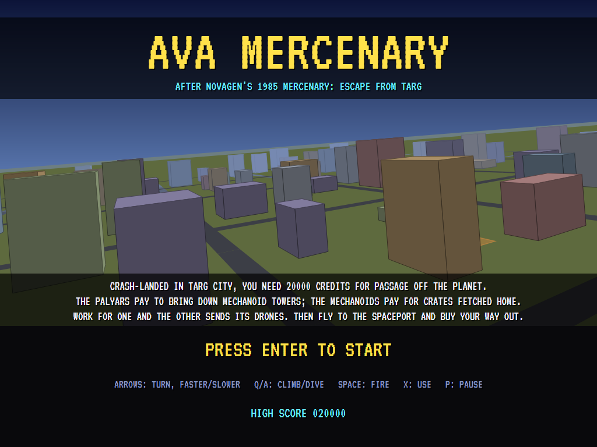
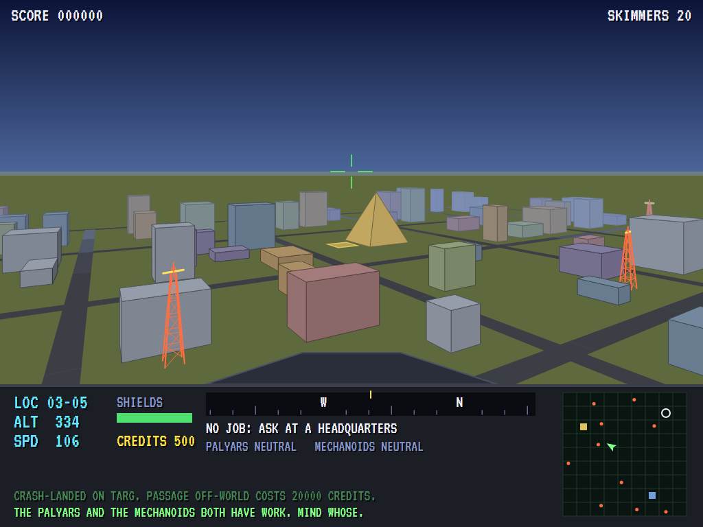
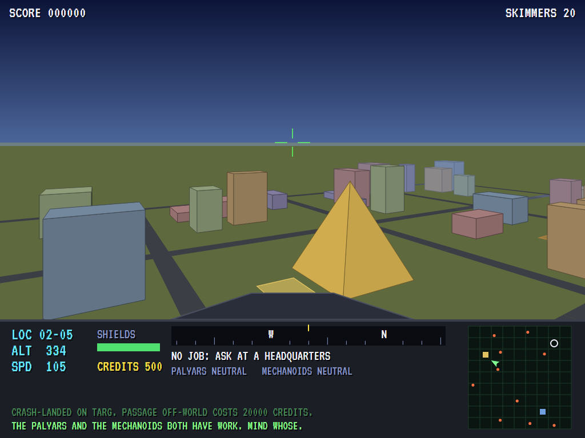
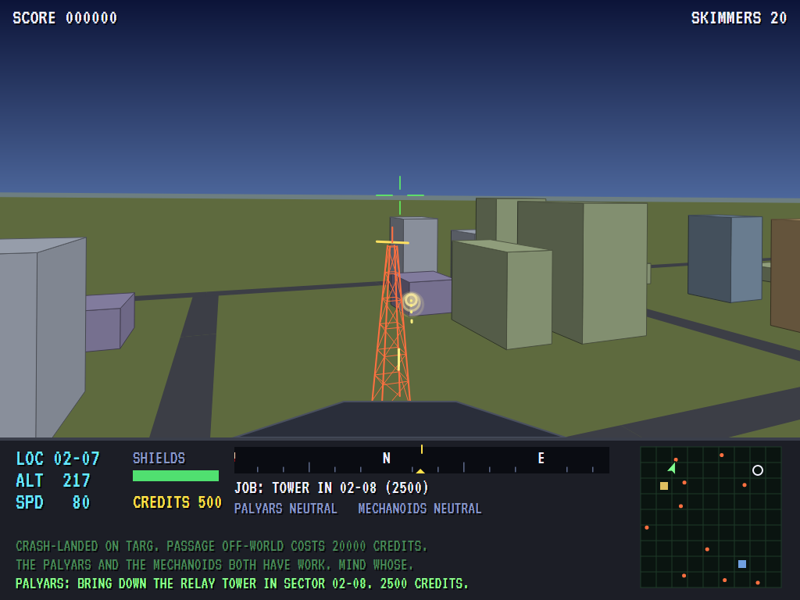
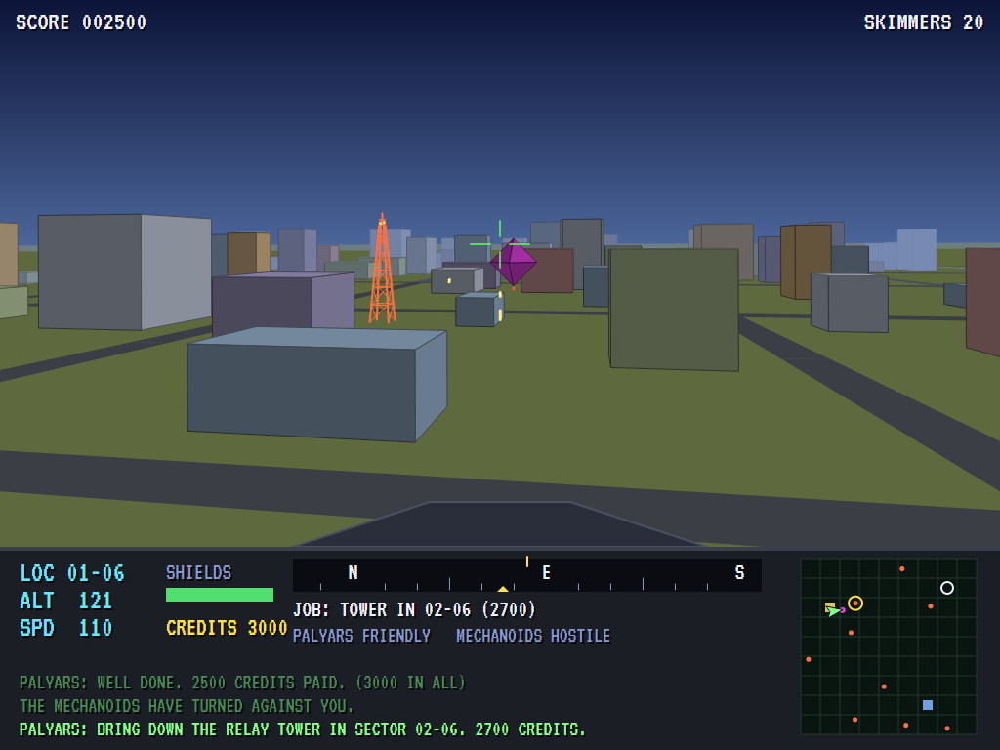
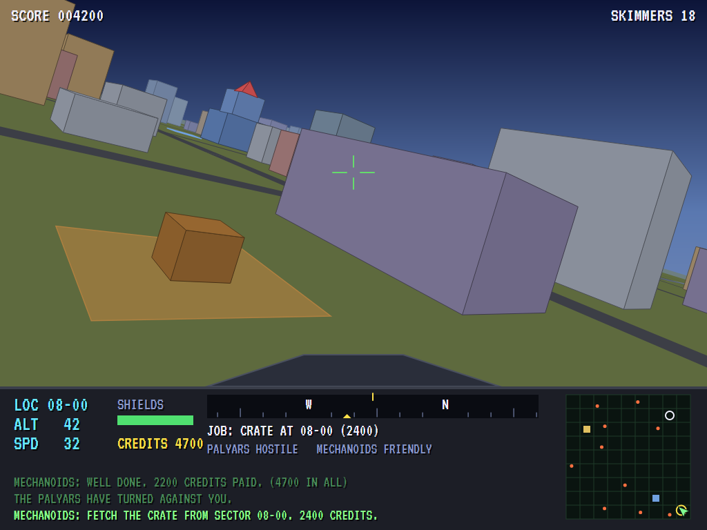
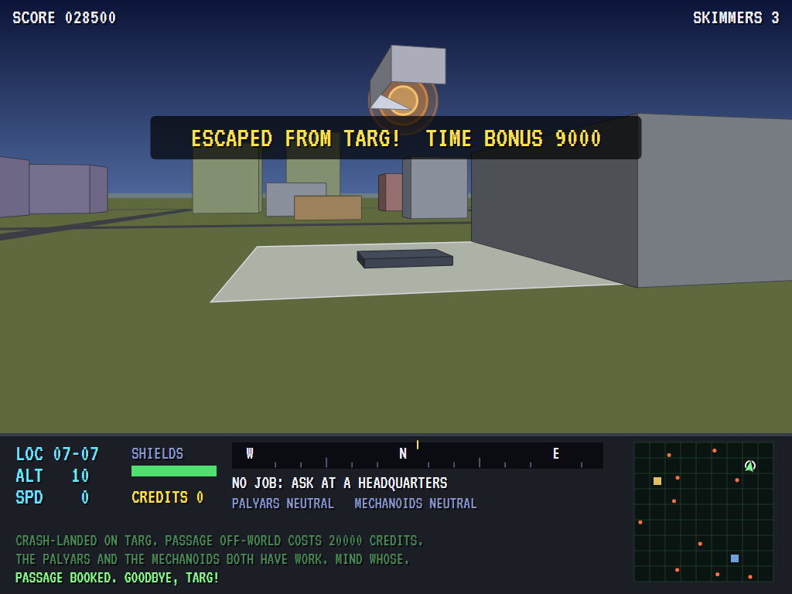
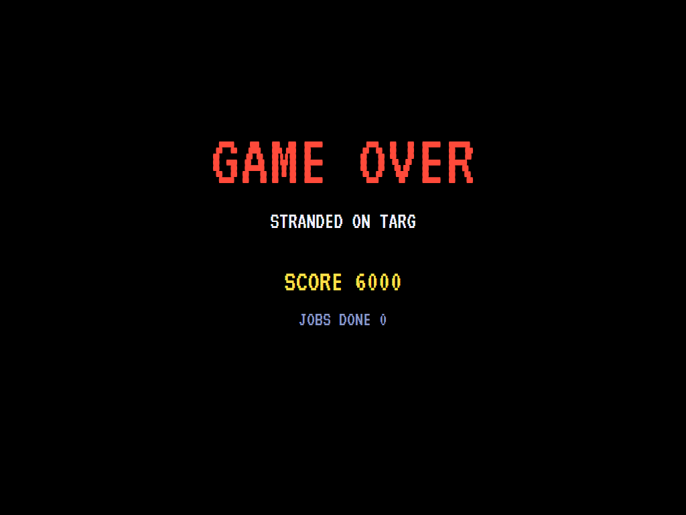
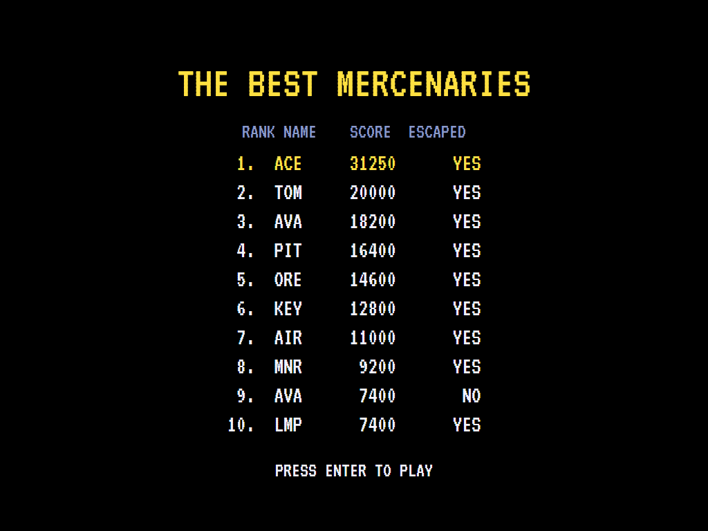

# AVA Mercenary

[](https://github.com/Harlock123/AVAMercenary/actions/workflows/build.yml)

A first-person flight through a solid 3D city, in the style of Novagen's 1985 game **Mercenary: Escape from
Targ**. It's built with .NET 10 and Avalonia UI. You've crash-landed on Targ, and passage off the planet
costs 20,000 credits. Two factions will pay for work. The Palyars want the Mechanoids' relay towers brought
down, and the Mechanoids want crates fetched home. Whoever you work for, the other side turns against you
and sends its drones. Earn the fare, fly to the spaceport and buy your way out.

## Features

- **A solid 3D city**, nine sectors by nine. Every building is a lit, shaded solid, drawn farthest first and
  faded into the haze, with the roads between the blocks. The Palyars live in a golden pyramid, and the
  Mechanoids in a stepped blue tower. Relay towers are lattice masts with a turning aerial on top, and the
  view tilts as the skimmer banks.
- **The skimmer:** turn, fly forward and slow down (and back off), climb and dive. You can settle on a
  rooftop. Fly into a wall fast and it hurts. Shields build back up slowly.
- **Jobs:** set down at a faction's headquarters and press Use to take one. Bring down the tower the
  Palyars name, or collect a crate from a depot and land it at the Mechanoids' door. The pay rises with
  every job you do.
- **Whose side you're on:** each job pleases the faction you did it for and angers the other twice as
  much. Bring down a tower nobody asked for, and the Mechanoids take it badly too. A faction that has
  turned against you won't deal with you, and its drones come hunting. Lose a skimmer and the crate it
  carried goes back to a depot.
- **Your gun** tips up or down onto whatever is near the line of fire. Bolts stop at walls, so you have to
  see the tower to hit it.
- **The instrument panel:** sector, altitude and speed, shields, credits, and a compass strip with a mark
  for where the job is. There's a map of the city with the headquarters, the spaceport, the towers still
  standing, drones and the job, and the ship's computer reports what happens. It speaks too: "Welcome
  to Targ" and "Credits paid".
- **The score** is every credit you earn, plus a bonus for the time to spare when you escape.
- **The attract mode** shows the computer mercenary at work. It works for the Palyars until they turn on
  it, then for the Mechanoids. It climbs over the rooftops to cross the city, stands off to shoot a tower
  from above anything in the way, turns to fight drones, and flies to the spaceport once it has the fare.

## Screenshots

| The title | Over the city | The Palyars |
|:---------:|:-------------:|:-----------:|
|  |  |  |
| Targ city behind the title. | Cruising over the rooftops. | Coming in to the pyramid for work. |

| A tower | A drone | A crate |
|:-------:|:-------:|:-------:|
|  |  |  |
| Bringing down a relay tower. | The Mechanoids send a drone. | A crate waiting at a depot. |

| Escaped | Game over | The best mercenaries |
|:-------:|:---------:|:--------------------:|
|  |  |  |
| Passage paid: off Targ. | | |

The screenshots are made by the tests, which play the game in a real (headless) window; see
[Tests](#tests).

## Download and run

Ready-to-run builds for Windows, macOS and Linux, on both Intel/AMD and ARM, are on the
[Releases page](https://github.com/Harlock123/AVAMercenary/releases/tag/latest). **Latest build** is
rebuilt on every push to `main`. Each download is one self-contained executable: no .NET install is
needed.

| Platform | Archive |
|---|---|
| Windows | `AVAMercenary-win-x64.zip`, `AVAMercenary-win-x86.zip`, `AVAMercenary-win-arm64.zip` |
| macOS | `AVAMercenary-osx-arm64.tar.gz` (Apple silicon), `AVAMercenary-osx-x64.tar.gz` (Intel) |
| Linux | `AVAMercenary-linux-x64.tar.gz`, `AVAMercenary-linux-arm64.tar.gz`, `AVAMercenary-linux-arm.tar.gz` |

```bash
tar -xzf AVAMercenary-linux-x64.tar.gz     # or linux-arm64, linux-arm, osx-arm64, osx-x64
./AVAMercenary
```

On Windows, unzip and run `AVAMercenary.exe`. On macOS, if Gatekeeper refuses to open it, run
`xattr -d com.apple.quarantine AVAMercenary` once. Run with `--no-audio` for silence.

**Sound** comes through OpenAL Soft, built in for every platform. In a virtual machine the game
detects it and uses a larger audio buffer, so the sound doesn't break up.

**Gamepads** use SDL2, which is bundled for Windows, macOS and Intel/AMD Linux. ARM Linux builds need it
installed; without it the keyboard still works:

```bash
sudo apt install libsdl2-dev            # Debian / Ubuntu / Raspberry Pi OS
sudo pacman -S --needed sdl2-compat     # Arch / Omarchy
```

## Controls

| Action | Keyboard | Gamepad |
|---|---|---|
| Start | Enter or 1 | Start |
| Turn | Left/right arrows | Left stick / D-pad |
| Forward / slow down and back off | Up / down arrows | Up / down |
| Climb / dive | Q, W or Page Up / A, S or Page Down | Right / left bumper |
| Fire | Space, Z or Ctrl | A or right trigger |
| Use (take a job, pick up a crate, buy passage) | X or E | B or X |
| Pause | P or Esc | Start |
| Sound on/off | M | |
| Screenshot | Ctrl+S (to your Pictures folder) | |

On the high-score table, type your initials, or use up/down and Space, then Enter.

## Tests

```bash
dotnet test AVAMercenary.slnx
```

The game runs in fixed 60 Hz steps, so it plays the same at any frame rate. Everything that moves lives in
one world that can be copied. The tests check:

- **The city:** the same seed builds the same city; ten towers stand in the open, well apart; the pads,
  depots and crash site are open ground; the headquarters stand where the factions live; sectors are
  named by column and row; and every block stays off the roads.
- **Flying:** the way it heads, turning, climbing and diving; slowing, backing off and drifting to a stop;
  a wall stopping it and hurting it at speed; settling on a roof; shields building back up.
- **Jobs:** the Palyars give work only to a skimmer landed at their door; bringing down the tower pays
  and turns the Mechanoids against you; a tower brought down for nobody angers them; a crate fetched
  home for the Mechanoids; one job at a time, and no work for a traitor; passage sold only for the
  full price.
- **Drones and bolts:** a hostile faction sending drones that shoot, and friendly ones sending none; a
  drone shot down; bolts stopping at walls.
- **The game:** credits scored, and the time bonus on escaping; the next skimmer at the crash site with
  the crate gone back to a depot; the last one lost and the high-score table; the demonstration; pause;
  "shields low"; getting paid announced; the keys, through to the skimmer.

`tests/AVAMercenary.Tests/PilotProbe.cs` reports how the computer mercenary gets on in five cities, for
tuning (`MERC_PROBE=1`). It escapes from every one, in eight to fourteen minutes.
`MERC_PROBE=lazy` flies straight ahead and fires, which earns nothing.

The screenshot tests draw the real screen in a headless window. To refresh the README's pictures:

```bash
MERC_SHOTS=$PWD/Images dotnet test tests/AVAMercenary.Tests --filter ScreenshotTests
```

## Building

```bash
dotnet build AVAMercenary.slnx
dotnet run --project src/AVAMercenary
```

Needs the .NET 10 SDK. The sounds, tunes and voice are made by `tools/make_sounds.py` (standard-library
Python, with the formant voice in `tools/speech.py`): `python3 tools/make_sounds.py` rewrites
`src/AVAMercenary/Sounds`.

## Project structure

```
AVAMercenary/
├── AVAMercenary.slnx
├── src/AVAMercenary/
│   ├── Engine/
│   │   ├── GameEngine.cs        # States, skimmers, the score, escaping, the title and demonstration
│   │   ├── Sim.cs               # The city step by step: flying, jobs, the factions, drones, bolts
│   │   ├── World.cs             # Everything that moves or changes, kept together so it can be copied
│   │   ├── City.cs              # The buildings, towers, depots, headquarters and spaceport
│   │   ├── Pilot.cs             # The computer mercenary (the demonstration, and the tests)
│   │   ├── HighScoreTable.cs, InitialsEntry.cs
│   │   ├── InputHandler.cs, ControllerManager.cs  # Keys and an SDL2 gamepad
│   │   └── SoundManager.cs      # Effects, tunes and voice through OpenAL
│   ├── Audio/                   # The OpenAL engine (from the author's AVABand)
│   ├── Views/GameCanvas*.cs     # The 3D city, the instrument panel and map, the title
│   └── Sounds/                  # The synthesised effects, tunes and voice
├── tests/AVAMercenary.Tests/    # City, gameplay and screenshot tests
├── tools/make_sounds.py, tools/speech.py
└── Images/                      # Screenshots
```

## About and licence

AVA Mercenary © 2026 Lonnie Watson, under the [MIT License](LICENSE).

*Mercenary: Escape from Targ* © 1985 Novagen Software (written by Paul Woakes). The names *Mercenary*,
*Targ*, *Palyar* and *Mechanoid* belong to their current owner. AVA Mercenary is an independent, unofficial
game in its style. Its city, graphics, sounds, tunes and code are its own; nothing is taken from the
original game's program, graphics or sound. It is not affiliated with or endorsed by any rights holder.
